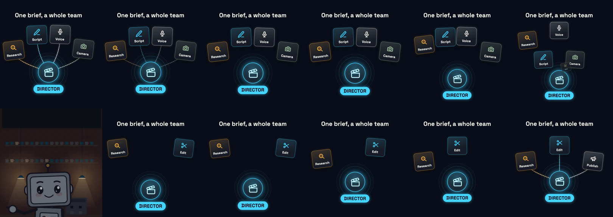
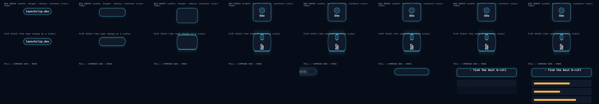

# RFC: Fluid, connected motion

Status: draft, open for review
Date: 2026-11-16
Roadmap entry: "Fluid, connected motion, in explainers and animation alike"
([ROADMAP.md](ROADMAP.md))
Builds on: [KIT_CONTRACTS.md](KIT_CONTRACTS.md) (catalogue B/H view tree and
op list, shot states, motion grammar), [DIRECTION_GUARDRAILS.md](DIRECTION_GUARDRAILS.md)
§8 (the motion check), [ANIMATION_PIPELINE_RFC.md](ANIMATION_PIPELINE_RFC.md)
(characters), [DUAL_RENDERER_PLAN.md](DUAL_RENDERER_PLAN.md)

## 1. Summary

A LaunchClip scene today is one module that enters, builds, holds and leaves.
Inside that window the `kinetic` feel moves the camera (drift, zoom kicks, whip
cuts) and shot states change a module's params, but the elements themselves
mostly arrive and then stand still, and nothing carries from one scene to the
next. The reference we are aiming at is a short reel where a robot stands in a
bakery, seven agent cards fly up and fan out above it, glowing wires connect
each card to a "director" node, pulses of light run down the wires and light
the director as they land, and every card keeps breathing and drifting until it
moves on to its next arrangement. Nothing is a static box.

This RFC covers six abilities, each written as frame-pure ops that both
renderers already know how to play, so nothing here needs a new runtime:

| # | Ability | Where it lives | Phase |
|---|---|---|---|
| 1 | Elements carried across scenes, settling into a new layout | story `carry` + a hand-off op pass | 3 |
| 2 | Group motion: flock, wave, fan, unison with offsets | `kit/core/fluid-motion.mjs` | 1 (slice) |
| 3 | Per-element idle motion tied to the grammar | `kit/core/fluid-motion.mjs` | 1 (slice) |
| 4 | Node graphs: glowing wires, travelling pulses, nodes lit on arrival | `node-graph` module | 1 (slice) |
| 5 | Characters reacting to graphics | cast cues targeting a module anchor | 4 |
| 6 | Planner-drawn graphics (a card with its own icon, a prop, a badge) | `graphic` spec drawn by a shared painter | 5 |

Plus two timing devices used by all of them: a **beat grid** (hits land on
beats, a short camera shake on impact) and an optional **loop** (the last
frame equals the first).

## 2. Constraints every part keeps

- **Frame-pure and seek-safe.** Every value is a function of the scene clock
  and the model. No `requestAnimationFrame`, no accumulated state, no random
  numbers that are not seeded by ids. A seek to any frame renders the same
  pixels as playing up to it.
- **One op list, two players.** Motion is expressed as catalogue B/H ops
  (`set`, `tween`, `loop` on element ids; props `opacity`, `x`, `y`,
  `scaleX`, `scaleY`, `rotation`, `strokeDashoffset`, `blur`, clip, `text`).
  HyperFrames plays them as calls on its paused GSAP timeline
  (`opsToGsap`); Remotion evaluates them with `frameState`. Anything that can
  be said as ops is in parity by construction; the parity harness checks the
  pixels.
- **Layers, not overlapping tweens.** An element that has an entrance, a group
  motion and an idle motion gets one wrapper per layer (`…-card-3` for layout
  and group moves, `…-card-3-idle` for the breath, the face inside). Two
  tweens never fight over one prop on one target, which keeps GSAP and
  `frameState` agreeing about who wins, and keeps the motion check's per-element
  reading honest.
- **Camera rules stay.** The camera eases slow → fast → slow and never
  overshoots; blur only at peak speed. Elements may overshoot (a card's
  back-ease landing), the camera may not. The impact shake (§8) is a decaying
  displacement, not a spring past the rest pose.

## 3. Group motion (phase 1)

A group is a list of members with a **slot** each (where it rests) and a
**pattern** that says how the group gets there and moves while it is there.
`kit/core/fluid-motion.mjs` turns a pattern into per-member ops:

| Pattern | Reads as | Per-member offset |
|---|---|---|
| `flock` | members leave one point together and spread to their slots on curved paths | delay by index (golden-ratio jitter), x and y on different eases so each path arcs |
| `wave` | a ripple passes through a settled group | delay by position along the group's main axis |
| `fan` | members open from a stack into an arc | rotation and position from the stack angle to the slot angle, delay from the centre out |
| `unison` | a march: every member makes the same move | the same move, each a few frames late (0.03–0.06 s) |

The offsets are what make a group look alive. They are deterministic: a hash of
the member id and index, never `Math.random`. The grammar scales them
(`grammarStagger`): `snappy` tightens them, `playful` loosens them.

A group pattern is a function `(members, {at, from?, grammar}) → ops`, so any
catalogue H module can call it for its own parts. The first slice uses `flock`
for the node-graph's cards and `wave` for the ripple when every wire fires at
once.

## 4. Idle motion (phase 1)

While an element is on screen and not mid-gesture, it breathes: a slow bob in
`y`, a small tilt and, for glows, an opacity swell. Idle motion is written as a
chain of `sine.inOut` half-cycles on the element's `-idle` wrapper, from the
moment it lands to the scene's exit:

- **Period** 3.2–4.4 s per full cycle (each half at least 1.6 s), offset per
  element by a hash of its id, so no two members breathe in step.
- **Amplitude** from the grammar: a base of 10 px of bob and 1.8° of tilt at
  1080 px, scaled ×1.2 `snappy`, ×1.4 `playful`, ×0.8 `smooth`,
  ×0.7 `cinematic`, ×0.5 `documentary`, ×1 `editorial`.
- **Why half-cycles of 1.6 s or more:** the motion check reads a tween longer
  than `MOTION_CHECK.gesture` (1.5 s) as continuous motion, not a gesture, so
  idle never counts towards the crowding rule and never looks like an entrance.

Idle stops (tweens back to rest over its own half-cycle) before the element's
exit, so exits start from a known pose.

## 5. Node graphs with wires and pulses (phase 1: the first slice)

A new catalogue I module, `node-graph`:

- **Nodes** (3–8) with an icon and a short label, laid out as a fan above a
  **hub** (the director). Portrait and landscape both: nodes sit on two
  staggered arcs round the hub so seven labels fit across 1080 px.
- **Wires**: one cubic per node from the node's centre to the hub's centre,
  drawn under both, so a node's idle bob never shows a loose end. A wire is a
  dim base stroke with a soft drop-shadow glow, and it draws on
  (`strokeDashoffset` 1 → 0) after its node lands.
- **Pulses**: a short bright dash on a copy of the wire path
  (`pathLength = 1`, `strokeDasharray = "L 2"`); tweening `strokeDashoffset`
  from `L` to `-1` runs the dash from the node to the hub. Both renderers
  draw a stroked dash the same way, so the pulse needs no sampled positions.
  A pulse travels in at most 0.9 of a beat, so one wire never carries two.
- **Flow**: between pulses, dots stream down every wire (a dotted copy whose
  `strokeDashoffset` runs linearly for the rest of the scene), so the graph
  never holds still. The first 9:16 render without it was 76% near-still
  frames by the render motion gate; with it and the idle breath, 17%.
  That still failed finish's motion gate (at most 10%): the dots and the
  breath are too small to register on its 72×128 grid, so between beats only
  the camera does. The golden samples now breathe the kinetic ambient faster
  (`shift` 0.014, `period` 2.5–4 s) and open with a kick at 0.25 s (an
  earlier one is dropped), for 3% near-still. `node-graph-9x16` also
  converges at 3 s, inside the 4 s hook; at 4.5 s its climax counted
  toward the body and the pace gate failed `flat-hook`.
- **Lighting on arrival**: when a pulse reaches the hub, the hub's ring flashes
  (scale and opacity out) and the hub core brightens; when a pulse leaves, its
  node's rim lights. These are short flashes, which the motion check already
  treats as pulses rather than entrances (`MOTION_CHECK.pulse`).
- **Converge**: one beat where every wire fires at once; the hub takes the
  impact (a punch and the camera shake, §8) and the nodes ripple (`wave`).
- **Events**: `build`, `node-<id>` (each landing), `converge`. A hit can move
  any of them, as with every catalogue module.

## 6. Elements carried across scenes (phase 3)

The hard one: a row of cards in scene A flies up into a fan above a character
in scene B, instead of cutting to a fresh layout.

**Contract.** A scene names elements it hands on and the next scene names the
slots that receive them:

```json
{"id": "s2", "module": "node-graph", "carry": {"from": "s1", "map": {"s1-card-0": "s2-node-0", "s1-card-1": "s2-node-1"}}}
```

**Mechanism (FLIP between scenes).** At resolve time both models exist, so the
planner pass knows the first rect (the element's last pose in A, from A's view
tree and `frameState` at A's end) and the last rect (its slot in B). It then:

1. holds A's element until the boundary instead of running its exit;
2. starts B's receiving element at A's rect, expressed as an `x`, `y`,
   `scaleX`, `scaleY` offset from its own slot (the "invert");
3. tweens the offset to zero over the hand-off (the "play"), with a group
   pattern so the members arrive as a flock rather than in lockstep.

Because both sides are ordinary ops on ordinary ids, the renderers need nothing
new. The transition between A and B for carried elements is a cut on the
same frame (A's copy hides as B's shows), so they never double.



Sample: `examples/story/flow-carry-9x16` (top row 3.5–5.2 s across the first
cut, bottom row 9.9–12 s across the cutaway and back).

### 6.1 The switch: `story.motion.flow`

Carry is an enhancement a feel or a style turns on, not something the planner
has to write per scene.

```json
{"motion": {"feel": "steady", "flow": true}}
{"motion": {"flow": {"carry": "auto", "pin": true}}}
```

- `motion.flow`: `true` (the same as `{carry: "auto", pin: true}`), `false`,
  or `{carry: "auto" | false, pin: true | false}`. Nothing else is accepted,
  and the story schema says so.
- **Feel defaults.** `kinetic` and `steady` turn flow on; `snap` leaves it off
  (snap is about hard jumps); no feel leaves it off. An explicit
  `motion.flow` (`false` included) beats the feel's default.
- **Style packs.** Seeded styles draw flow with the rest of the motion feel
  (`drawMotionFeel`, kit/core/style-feel.mjs): calm and premium tones always
  have it, the other tones by a seeded chance. It is written as
  `motion.flow` in the pack, and `storyMotionOf` (kit/core/style.mjs) passes
  it to the story with the grammar and feel, so a style turns it on with no
  planner work.
- **Per scene.** A scene's own `carry` map replaces the automatic pairing at
  its boundary; `carry: false` opts that scene out.
- **Planner.** The prompt gets one sentence: with flow on, leave the boundary
  between two scenes that share elements a cut (no `in`), a pan, a
  whip-pan, a push or a whip, and the engine carries what they share.

### 6.2 Pairing (a resolve pass)

With flow on, every scene B is paired with its **source** A: the last earlier
scene on the same track whose module is an op-list module (catalogue B, G or
H), when only footage or a gap lies between them. That covers both a scene
that follows another directly and a graphics plate that comes back after a
footage cutaway: B resumes where A left off instead of rebuilding.

Pairing needs a **still plate** or a **pan of the camera** at the boundary,
and skips the boundary otherwise (an explicit `carry` map that breaks one of
these is a validation error that names it):

- A and B are on the same track and both are op-list modules;
- B arrives by a cut (no `in`, or `in.type` `"cut"`), by a `pan` or
  `whip-pan` of the camera (world-camera or cuts story), or by a `push` or
  `whip` slide. Across a camera move A's rect is mapped through the two
  plates' world placements, across a slide by B's layer offset, and the
  element travels with the move (§6.5). A push, pull, orbit or
  overview changes the camera's zoom or roll, and they and every other typed
  transition keep their own look. A world-camera cut stacks B on A's
  placement, so it is a still plate. A feel's ambient camera and kicks are
  fine: they move the whole composition, so A and B still share one
  coordinate space;
- a module's own camera (node-graph's slow push, a zoom inside the shot) is
  allowed, because rects are measured through it (below). The per-scene hold
  drift (kit/core/ambient.mjs `sceneDrift`) is not: it restarts on every
  scene, so a carry turns it off on both sides of the boundary.

The candidates on each side are the module's **elements**: nodes with an id
and a box whose nearest id-bearing ancestor is the module root or a wrapper
that fills the module's rect (node-graph's `-cam`). Inner parts (`-idle`,
`-lit`, a label inside a card) travel with their element. An element's
**kind** is its id after the scene prefix with a trailing indexed token
dropped (`node-n0` → `node`, `item-3` → `item`, `hub-label` stays
`hub-label`).

1. **Pins** (with `pin` on): an element of A and one of B with the same id
   suffix, the same subtree (ids aside) and the same rect on screen at the
   boundary stay on the plate: no exit, no entrance, no tween.
2. **Carries** (with `carry: "auto"`): of what is left, elements of the same
   kind with the same text pair greedily, nearest centres first.

An explicit map names full DOM ids on both sides, as above, with an optional
`from` (the source by default). An entry whose two rects match is a pin; any
other is a carry. A map may pair elements whose text differs: B's content then
shows on the boundary frame inside the moving box (a swap, not a morph).

### 6.3 What the pass does to the two models

Everything below is a change to the shared view tree and op list, made in
kit/core (`resolveModule` tags the models; the catalogue B, G and H view and
timeline functions apply it), so both renderers draw it with no new code.

- **The root's exit and entrance are lifted.** A module's root normally fades
  and slides as one, which would take a held element with it. When A hands
  elements on, A's root no longer exits: every element that is not handed on
  and not on the way to one is wrapped in a layer (`<id>-lift`, the size of
  its parent, its transform origin at the module's centre) that plays the
  root's exit instead, so the rest leaves exactly as it did. B's root entrance
  is lifted the same way.
- **A holds.** Handed elements and their ancestors drop their own ops from
  the exit on, so they stay in their last pose until A's last frame.
- **B skips the entrance of what it receives.** For each received element and
  its ancestors, each prop that starts away from its rest value (hidden,
  offset, undrawn) is set at B's start to where its first move takes it, and
  that first move is dropped. Rest is the value the prop holds for most of
  the scene, so an overlay that rests hidden and only flashes (node-graph's
  lit rim, the hub's ring) is not an entrance. Later moves (idle, a wave, a
  shot state, a pulse lighting the card) still play.
- **Rects at the boundary** are visual: the element's layout box mapped
  through its own and every ancestor's transform at A's last frame (the
  module root at rest), and at B's first frame for the slot. That is what
  lets a module's own camera stay on.
- **Pin:** nothing more; A's copy hides and B's shows on the same frame.
- **Carry:** B's element starts at A's rect, as an `x`, `y`, `scaleX`,
  `scaleY` and `rotation` offset from its slot, and tweens to the slot over
  0.7 s (scaled by the grammar's camera duration, 0.5–1 s): slow → fast → slow,
  `x` on `power2.inOut` and `y` on `power3.inOut` so the path arcs slightly,
  scale and rotation on `power3.inOut`, no overshoot. Members leave in order
  of distance a hashed 0.04–0.1 s apart, so a group arrives as a flock. There
  is no per-element blur; a story's `motion.blur` smears the fast middle of
  the move and leaves the ends sharp.

**Unproven.** Camera moves that change zoom or roll (push, pull, orbit,
overview) are out (§6.5). Text
that reflows between layouts (a card that grows) is a cross-fade inside the
moving card, not a morph.

**Reference notes (2026-11-17).** A second reel shows carry working through a
talking-head video: graphics sit on a dark dot-grid plate above the speaker,
with cutaways to the speaker full frame between beats. What makes it read as
one continuous piece, and what it adds to this section:

- **The plate survives footage cutaways.** When the cut returns to the
  graphics, they resume where they left off rather than rebuilding. The plate
  never moves its camera, so it meets the "same coordinate space" condition
  above by construction. That makes it a good first target for phase 3.
- **Pinned elements.** A hub mark at the top stays put across several beats
  while content below it changes. This is simpler than carry (same rect on
  both sides, so no FLIP) and could ship first: a carried id whose slot equals
  its last rect.
- **Container morph.** A URL pill becomes a node; a search pill streaks in
  (motion blur at peak speed), becomes a command bar, then three empty rows
  drop in under it and fill in turn. The shape itself changes, which this
  section currently rules out. Worth testing a rect-only morph (tween width,
  height and corner radius of the box, cross-fade the contents) before
  deciding it stays out.
- **Growth from what's already there.** Labels branch out of an ad card on
  wires and icons branch out of the hub, so nothing new appears unattached.
  `node-graph` wires already do this; the gap is wires from an arbitrary
  element of another module, which needs the anchors in §7.

### 6.4 Growth from existing elements

New things branch out of something already on screen, on wires, instead of
appearing unattached: labels sprout from an ad card, icons from a hub. A
catalogue I module, `sprout`, draws the growth as an overlay on a higher track,
aimed at another scene's anchor (§7):

```json
{"id": "grow", "module": "sprout", "track": 1, "start": 0.6, "end": 5,
 "params": {"from": {"scene": "ad", "anchor": "card"}, "branches": [{"label": "Copy", "icon": "pen-line"}, {"label": "Images", "icon": "image"}]}}
```

- **Params.** `from` `{scene, anchor}` (required); `branches` 1–4, each a label
  ≤ 16 or `{label, icon?, id?}`; `side` `auto` (default: the side of the
  source with the most room), `below`, `above`, `left` or `right`; `tone`;
  `at` (when the first wire leaves; default half a beat after the anchor
  lands, on the beat grid); `bpm`.
- **Wires are node-graph's.** The base stroke with its glow that draws on, the
  dots that stream down it and the pulse are one shared drawer in
  `catalog-i-graph.mjs`, used by both modules. A sprout wire runs from the
  source's edge (the edge facing the labels, spread across its middle) to the
  near edge of its label, as a cubic with tangents along the growth.
- **Growth.** Wires leave the source a quarter beat apart, nearest the anchor
  first; each draws over 0.45 s (`power2.inOut`) and its label lands as the
  wire reaches it (fades and scales up from 0.7 and slides out along the wire,
  `power3.out`), then breathes. Once all have landed, a pulse runs from the
  source to one label per beat, and the label's rim lights as it arrives.
- **Events:** `build` (the first wire leaves), `branch-<id>` (each landing). A hit can move them.
- **Anchors carry a box.** `publishAnchors` adds the element's `width` and
  `height`, so a sprout leaves from the source's edge, and `concept-card`
  publishes `card` (its rect, at `word`) and `icon` (at `icon`).
- **The source must be on screen** for the sprout's whole run. In one scene:
  the anchor's scene covers it. Across scenes on a shared still plate: the
  anchor's element is pinned (§6.2, by an explicit `carry.map` or by
  `motion.flow`) into the next scene, and the chain of pins covers it. A
  carry that moves the element (the FLIP) ends the chain. An anchor that is published
  with an `until` before the sprout ends is a validation error that names the
  time it leaves.
- **Errors** name the param: an unknown scene, a scene that publishes no
  anchors, an unknown anchor, a source that is gone before the sprout ends,
  an `at` before the anchor lands, labels that do not fit on the side.

**Shipped.** As above, in `kit/core/catalog-i-graph.mjs` (node-graph's wires
became the shared `wireNodes`, `wireOps` and `pulseOps`, with node-graph's
output unchanged). The catalogue G card surface has an id (`<id>-card`), so a
card can be pinned and aimed at. `sprout` is not standalone, so the single-scene
element sheets and fixtures skip it, and story parity covers it:
`examples/story/sprout-ad-card-9x16` grows Copy and Images out of an ad card,
pins the card across a cut, and grows Video from the previous scene's anchor
(SSIM 0.992–0.994 at six times).

**Unproven.** Anchors are measured at rest, so a wire's end does not follow a
source that moves (a carry's FLIP, a node's idle bob of a few pixels). A carried
source is out until a wire end can follow its ops.

### 6.5 Carry through a moving camera

R&D: [rd/carry-moving-camera.md](rd/carry-moving-camera.md). A world-camera
video is one continuous space, so carrying an element across a camera move is
the camera travelling past it.

- **Rects.** On the boundary frame (B's start, the move's first frame) the
  camera rests on A, so A's canvas px are screen px. A's box goes through A's
  placement into the world and back through B's into B's canvas px (scale by
  the placements' ratio, rotation by their difference): `mapBox`,
  kit/core/flow.mjs. The flow pass builds its own camera plan with bare
  models, so it never resolves a carried one. Nothing is a pin across a move:
  the plates sit apart in the world.
- **The move.** B's FLIP takes the camera move's start, duration and ease on
  every prop, with no flock gap. With zoom and roll constant, the element's
  screen position is then a straight line from where it was on A to its slot
  on B, on the camera's own slow → fast → slow: a title in the same slot
  holds still while the plates slide past; a card that changes slot glides
  there. Any lag against the camera would swing it off that line, so members
  move together.
- **A's side.** A is drawn on through the move (its `renderEnd`), so its
  handed copies hide with an `opacity: 0` set on the boundary.
- **Slides.** A `push` or `whip` in a cuts story (and a typed `whip` in a
  world one) does not move the camera: B's layer starts a frame's width or
  height away and eases home while A's leaves. That is a camera move in all
  but name, so A's rect is offset by B's layer at the boundary and the
  element travels with the layer's tween (its timing and ease). The whip's
  layer blur takes the element with it, as the camera blur does.
- **Blur.** The camera's directional blur is on the camera container, so a
  carried element takes the camera's smear at peak speed: right for a card
  that glides with the camera, a 2–4 frame smear on a whip for one that holds
  still on screen.

Samples: `examples/story/flow-camera-9x16` (a pan at 4 s, a whip-pan at
8 s), `examples/story/flow-slide-9x16` (a push at 4 s, a whip at 8 s).

## 7. Characters reacting to graphics (phase 4)

Cast scenes already direct gaze and gestures at targets
(`kit/core/characters/actions.mjs`: `gaze-at`, `point-at`, named targets). A
module that shares a plate with a cast scene publishes **anchors**: named
points with times (`node-graph` publishes `hub`, `node-<id>` and the time each
lands). A cast cue can then target `{scene: "s2", anchor: "node-3"}`, and the
cue's time defaults to that anchor's event, so the character looks at the card
as it lands and raises its arms as the fan opens (`converge`).

**Shipped (phase 4).** `kit/core/anchors.mjs` makes publishing generic: a
catalogue module declares `anchors(model) → [{name, element, event}]`, and
`publishAnchors` measures each element on the module's view tree at rest
(its centre, canvas px) and takes the event's time, so any module that draws
its elements as a view tree can publish them without code of its own.
`modules.mjs` `sceneAnchors(story, id)` resolves a scene's anchors and hands
every module a memoised `ctx.anchorsOf`. `node-graph` publishes `hub` (at
`build`), `converge` (the hub, at `converge`) and `node-<id>` (each card's
centre as it lands).

A cast cue or actor `target` may be `{scene, anchor}`; a cue with one and no
`at` plays at the anchor's time, which is already on the beat grid (§8)
because the module's default event times are. An anchor is in the picture
plane, so the character keeps a front view and its face follows the point all
the way (`gazeOffset` drops its half-turn floor for plate points): four cards
side by side read as four looks, not one three-quarter turn. Errors name the
cue: an unknown scene, a scene whose module publishes none (listing those
that do), an unknown anchor (listing the scene's), and a defaulted time
outside the cast scene. Both renderers resolve modules through
`resolveModule`, so the cues are ordinary states and in parity by
construction; `examples/story/node-graph-anchors-9x16` is the sample and a
story parity fixture.

**Unproven.** Anchors are in the module's rect space; a cast scene's targets
are in its set's space. Both are canvas pixels on the same plate, which is
enough for a still camera; a world camera between them needs the same mapping
as §6. Anchors are measured at rest, so a camera move inside the module
(node-graph's slow 1 → 1.05 push) is not followed; at that size the look
still lands on the card.

## 8. Beat grid, impact shake, loop

- **Beat grid.** A module may take `bpm` (or the story's music tempo when
  `finish` knows it). Default cue times snap to the grid: the build on the
  first beat after the entrance, landings on half beats, pulses on beats,
  `converge` on the first bar line after every node has landed. An explicit
  `at` or a hit is honoured as given; only defaults snap.
- **Impact shake.** On an impact event the module's camera wrapper takes a
  decaying displacement: four tweens of 0.05–0.08 s whose amplitude halves each
  step (10 px → 0 at 1080 px), `power1.inOut` each. It never overshoots the
  rest pose by more than the step before and it is short enough (≤ 0.3 s) that
  the motion check reads it as one gesture.
- **Camera drift inside a module.** The camera wrapper also takes one slow push
  over the scene (scale 1 → 1.05, `power1.inOut`), so a settled frame is
  never still. It is a different prop from the shake, so the two compose.
- **Loop.** `loop: true` makes the last frame equal the first: every layer's
  idle chain is fitted to a whole number of cycles over the scene, pulses run
  on a period that divides the scene, and the module's enter and exit become
  matching states (its exit returns elements to their entrance pose). The
  check (§9) compares frame 0 with the last frame from `frameState`.

  **As shipped (phase 6).** `scene.loop: true` on a catalogue H or I module
  (any other module refuses it). The root leaves into its entrance pose and
  lands a frame early, since the next frame shown is the first again. A
  pass at the end of `catalogHTimeline` (`kit/core/loop.mjs`) drops element
  ops that would start once the exit has begun, then tweens every element
  that has moved back to its frame-0 state under the root's exit
  (`power2.inOut`): a node flies back into the hub, a wire undraws, a stream
  of dots runs home. Opacity comes home over the element's own fade-in, so
  no element leaves more than twice as slowly as it arrived. Idle chains
  take `fitTo` (`idleOps`): their half-cycles stretch or shrink, never under
  1.6 s, so the breath lands at rest exactly as the exit begins rather than
  stopping early. `node-graph` runs its pulses on the beat nearest its `bpm`
  that divides the scene (`fitBpm`) and sends none once the exit has begun.
  Because it is all ops, both renderers play it unchanged. `node-graph`,
  `icon-grid`, `social-wall` and `item-list` pass `loop-seam` looped and fail
  it without (`test/loop.test.js`), and each has a `h-*-loop-portrait`
  parity fixture.

  A whole short loops through the existing `ending.loop_to`, which draws the
  target scene's first state, frozen, over the final window, and returns the
  camera to it. `kit/core/story-loop.mjs` adds the story-level rules. A
  typed hand-back (`ending.in`) now lands on the last frame instead of one
  frame after it, so the last frame is the frozen first state with nothing of
  the outgoing scene left on it. The motion check warns `loop-target` when
  `loop_to` names a scene other than the opener, because replay would jump
  between the two. Layers that run on story time, such as the ambient blobs
  and a planned background's drift, fit a whole number of their cycles into
  the story (`fitAxes`). Without this, the first render of the sample failed
  `reel check` on the background alone: SSIM 0.93, with the blobs drifting
  on 19–21 s periods over an 18 s short. GL backgrounds run on a shader
  clock and are not fitted yet. The sample is `examples/story/loop-9x16`: node-graph,
  then icon-grid, then an item-list with `loop: true`, handing back to the
  opener with a 0.4 s fade. `launchclip reel check` measures the seam of a
  render.

## 9. The motion check

`kit/core/motion-check.mjs` reads every scene's ops. What this RFC adds should
pass it as designed, and it learns two things:

- **Continuous motion is not crowding.** Idle half-cycles are longer than
  `gesture`, so they are already excluded; the check also learns the
  `-idle` suffix, so an idle wrapper is never counted as an element of its
  own for `crowdElements`.
- **Flashes are not entrances.** Pulses and ring flashes appear and go within
  `pulse`. An element that flashes on every beat used to be read as one long
  life from its first fade-in to its last fade-out; the check now reads each
  fade-in and the fade-out after it as one flash (shipped in phase 1).
- **New findings** (phase 2, shipped): `static-hold` (warning) when a scene
  longer than 3 s has a settled stretch over 1.5 s where nothing on screen
  moves, which is what this whole entry is against; `loop-seam` (error) when
  `loop: true` and frame 0 differs from the last frame; `shake-overshoot`
  (error) when a camera shake's steps do not decay.

  **As shipped.** The idle suffix is in: an `-idle` target is neither an
  element nor a gesture for `crowded-move`. `static-hold` reads the ops, states
  and hits from the end of the entrance to the start of the exit; a scene with
  no op list is not measured, since its motion is not visible to the check.
  `shake-overshoot` reads three or more abutting x/y steps of 0.1 s or less on
  one target that reverse direction as a shake, and fails one whose step lands
  further from rest than the step before (by over half a pixel), that does
  not end at rest, or that runs over 0.3 s. `loop-seam` compares `frameState`
  at the model's start and one frame before its end, within half a pixel or
  degree and 1 % for opacity and scale; it runs on a model with `loop: true`
  (`scene.loop`, phase 6). The phase-1 `node-graph` sample has no
  still gap at all and its shake runs 0.24 s. Most older catalogue modules
  hold still after their entrance and warn `static-hold` until phase 5 gives
  them idle motion.

## 10. Planner-drawn graphics (phase 5)

The planner may describe a small graphic instead of picking only from the
catalogue: `{"graphic": {"kind": "card", "icon": "chef-hat", "label": "Baker",
"badge": "3"}}`. A shared painter turns that spec into a view-tree node in the
style's palette and type (the same node every catalogue H module draws with),
so it renders in both renderers and can be a member of any group above. The
spec is validated like module params; anything it cannot draw is a validation
error the planner can fix, never free-form HTML.

**The rule (decided 2026-11-17).** The `graphic` spec is a closed list and
stays one: card, chip, badge, ribbon, a prop from the world kit, any icon from
`kit/core/icons.mjs`, and text that fits. It does not grow. Anything past it
(a chart, a progress value, a photo or avatar, an arrow, a second line of
detail, a colour of its own, a graphic inside a graphic, free positions or
sizes) is its own catalogue module, with its own params, layout, parity
fixture and planner line, so the spec never turns into a small layout
language. Validation enforces the line: an unknown kind or a key no kind takes
fails with the nearest catalogue module that draws it (`beyondGraphic` in
`graphic.mjs`: `kind "bar-chart"` → the bar-chart module, `detail` →
concept-card, `children` → icon-grid or node-graph, `x` or `width` → the module
lays out its members) or says no module draws it yet, and a key another kind
takes names that kind. The planner prompt says the same in one line. Graphics
that recur past the list are module candidates in `docs/ROADMAP.md`.

**Shipped (first half).** `kit/core/graphic.mjs` holds the spec, the fit and
the painter:

| Kind | Fields | Drawn as |
|---|---|---|
| `card` | `icon?`, `label?`, `badge?` (≤ 3 chars); one of icon or label | node-graph's card (it now draws through the painter, byte for byte the same), with a count disc on its corner |
| `chip` | `label`, `icon?` | a pill in the member's colour over the panel |
| `badge` | `icon` or `text` (≤ 3 chars), `label?` | a glowing disc in the member's colour, ink on it |
| `ribbon` | `label`, `icon?` | a banner with notched tails, ink on the colour |
| `prop` | `prop` (a world-kit prop id), `state?`, `label?` | the world kit's drawing (`drawProp`) in the brand's colours |

- **Validation.** `graphicSpec` rejects an unknown kind, a key the kind does
  not take, a missing required field, an unknown icon (with near names) or
  prop (with the list), a state the prop does not have, and text over its
  length or with angle brackets. Every error names the path and what to
  change, so the planner can repair it like any module param.
- **Text that fits.** Widths are measured in label sizes (`graphicWidth`), so
  a module sizes its member to the widest graphic (node-graph) or fits the
  label to its cell (`fitGraphic`, icon-grid) and fails under the brand's
  meta size instead of clipping.
- **Members.** A `node-graph` node and an `icon-grid` item take
  `{graphic}` in place of their label and icon; the graphic sits inside the
  module's own layout and `-idle` wrappers, so it flocks, breathes, carries
  its wire and lights like the default member. A badge or prop has no face, so
  its label sits on a plate of the panel (a wire running under it stays
  hidden) and its lit rim is a glow from behind.
- **Planner.** The motion and voiceover-motion lane rules carry one paragraph
  on drawn graphics (`DRAWN_GRAPHICS` in `planning-prompt.mjs`), and both
  modules' param lines list the spec.
- **Proof.** Parity fixtures `h-node-graph-graphics-portrait` and
  `h-icon-grid-graphics-portrait` (every kind; min SSIM 0.996),
  `test/graphic.test.js`, and the sample `examples/story/graphics-9x16` (a
  robot in a kitchen before dawn, its seven-strong team drawn as two cards,
  one with a count badge, a chip, an icon badge, a number badge, a ribbon and
  a loaf). Seven nodes fit the golden's rect where five do not: five sit on
  taller tiers, and a chip or ribbon with an icon is wider than a card, which
  shrank the labels under the 26 px floor.

**Member modules: the hookup.** A member module is a catalogue module whose
job is to be one member of a set (a card on a wall, a pin on a map): the
forms past the closed list that other modules already take (`docs/ROADMAP.md`).
It joins a set through the same path a graphic does, extended rather than
doubled: `kit/core/members.mjs`. A set member is the module's default member,
`{graphic: {kind, …}}` (the closed list), or `{member: {module, …}}` (a member
module), never more than one, and the set reads either through the same calls:

| Call | What the set module uses it for |
|---|---|
| `memberOf(check, raw, path, {replaces, labelMax, base})` | the spec an item gives, or null for the default member; fails when `graphic` and `member` are both given, or either with the default member's own keys (`replaces`) |
| `memberWidth(spec, L)`, `fitMember(…)` | the width it needs at label size L; the largest label that fits a cell, failing under the brand's meta size |
| `memberHeight(spec, I, L)` | its height with an I px icon (a card's unless the member says otherwise); node-graph gives every node the tallest, icon-grid shrinks the icon until it fits the cell |
| `memberFace(spec)` | `card`: the set lights its rim; `glow`: it glows from behind |
| `memberNodes(spec, W, H, look)` | its view nodes inside the set's own layout and `-idle` wrappers, so it flocks, breathes and lights like the default member |
| `memberOps(ops, spec, {key, start, landAt, settle})` | its own ops after the set's flock and idle (status over time, a count) |

A member module is a plain object in `MEMBERS` (one line per module in
`members.mjs`): `id` (what `member.module` names), `describe`, `params` (its
planner line; `SET_MEMBER_PARAM` lists every one on the set modules'
params), `face`, `spec(check, raw, path, {labelMax, base})` returning a plain
spec with a `label` (the member's name, or null; `base` is the set's
`createHBase`, for colours and `timeOf`), `width(spec, L)` in proportion to L,
`height?(spec, I, L)`, `nodes(spec, W, H, look)` (the painter's `look`; ids
start with `look.key`, which is `<scene>-g-<node id>` in node-graph and
`<scene>-g-<index>` in icon-grid) and `timeline?(ops, spec, at)` (ops only on
its own ids; group and idle motion stay the set's, from `fluid-motion.mjs`).
`node-graph` and `icon-grid` take members today; another set module joins by
calling `memberOf` and the four draw calls where it now draws its default
member. Graphics draw byte for byte as before. `test/members.test.js` proves
the path with a stand-in member; each member module brings its own parity
fixture, tests and 9:16 sample.

Member modules shipped:

- `sub-card` (`kit/core/member-sub-card.mjs`): `{label, sub ≤ 24, icon?,
  badge?}`, the default card with a second line under its label, in the meta
  face and a muted ink, as map pins, grid-race and cell-grid carry theirs. The
  sub is the label's size, so the fit that keeps labels over the brand's meta
  floor keeps the sub over it too; the card is one line taller, and node-graph
  gives every node that height. A `sub`, `detail` or `subtitle` on a graphic
  now names it. Proof: `h-node-graph-sub-card-portrait`,
  `h-icon-grid-sub-card-portrait`, `test/member_sub_card.test.js`, and
  `examples/story/members-sub-9x16` (the bakery team, a line each). Five
  sub-cards fit the golden's 880 px rect at 31 px labels; seven do not.

## 11. Phases

1. **`node-graph` and `fluid-motion.mjs`** (this PR): flock, wave, idle, impact
   shake, beat grid, glowing wires with pulses, hub lit on arrival; schema,
   both renderers, parity fixtures, tests, a 9:16 sample.
2. **Motion check additions** (shipped): `static-hold`, `loop-seam`,
   `shake-overshoot`; the idle suffix in crowding.
3. **Carry across scenes** (§6) on still-camera plates, in four steps: pins
   (§6.2), carry with the FLIP, including a plate that comes back after a
   footage cutaway, the `motion.flow` switch (§6.1), then a container-morph
   test (R&D only, verdict in §12).
4. **Anchors and character reactions** (§7). Shipped. Growth from existing
   elements (§6.4, `sprout` on anchors) builds on them. Shipped.
5. **Planner-drawn graphics** (§10), then group patterns and idle on the other
   catalogue H modules that draw sets of things. Both halves have shipped. The
   first: the spec, the shared painter, and `node-graph` nodes and
   `icon-grid` items that take a graphic (§10). The second:
   `icon-grid` flocks out of the middle of the grid and breathes; `drop-grid`
   keeps its word-timed fall, rocks on its base once landed and ripples when
   full; `social-wall`'s field arrives as one wave along the drift and its
   pulled posts breathe; `item-list` (every layout already enters as a group)
   breathes once in. Each has a long 9:16 parity fixture (`h-*-idle-portrait`)
   that samples mid-breath. `examples/story/group-idle-9x16` shows all
   four. drop-grid's squash now settles on `power3.out` with no overshoot, and
   the impact carries in its contact shadow, which spreads on landing.
   Left out on purpose: `unit-grid` (up to a hundred tiny units, where a
   breath each is noise and a hundred more nodes), ranked and tabular sets
   (`leaderboard`, `comparison-table`, `heatmap`), whose rows must stay
   aligned to read, and modules that already move a set the whole time
   (`ticker-tape`, `live-bars`). `fan` and `unison` were not needed: the
   modules' own entrances already are those patterns.
6. **Loop** (§8), with the seam check. Shipped: `scene.loop` on catalogue H/I
   modules (the exit returns every element to its entrance pose, idle and
   pulses fitted to the scene), and a short that loops through
   `ending.loop_to` hands back on its last frame (`kit/core/story-loop.mjs`).

## 12. What is unproven

- ~~Carry through a moving camera or a moving transition (§6).~~ **Pans,
  whip-pans and the push and whip slides shipped (§6.5).** Still open
  ([rd/carry-moving-camera.md](rd/carry-moving-camera.md)): moves that zoom or
  roll (push, pull, orbit, overview), where the same world travel bulges about
  6% off its line mid-move and needs a layer that cancels the camera; blur
  from the element's own screen velocity rather than the camera's.
- ~~Whether a container morph (tween only the box's width, height and corner
  radius, cross-fade its contents) reads well enough to join auto-pairing.~~
  **Verdict (2026-11-17): it reads well; wire it in next, not yet.** The R&D
  sample ([docs/rd/container-morph.html](rd/container-morph.html), rendered 9:16
  with HyperFrames, below) runs a URL pill into a node card two ways. The box
  morph keeps the corners, the border width and the text crisp, and the beat
  where the box is briefly empty between the cross-fades (content out over
  0.25 s, in from 0.4 s) reads as the box becoming something, not as a gap. The
  same change as a FLIP scale squashes the label, turns the icon into an oval
  and stretches the border and radius, which is the failure §6 warned about.
  The reference's search pill → command bar → rows (a streak with blur only at
  peak speed, the bar growing, three rows dropping in and filling in turn) also
  reads cleanly. It is not wired into auto-pairing, because the op list has no
  `width`, `height` or `radius` props: both renderers need them first (GSAP
  tweens them natively, and Remotion's `propsToStyle` would map them), along
  with parity fixtures. Then a carry pair whose aspect ratio changes by more
  than about 1.3× should morph the box instead of scaling it.

  
- Whether idle on every element of a busy scene reads as alive or as nervous.
  What the set modules' 9:16 sample (`examples/story/group-idle-9x16`)
  showed: the grammar table holds for large elements (node-graph cards, a
  pulled post), but a fixed 10 px bob is too much for small members of a set.
  On 140 px icon tiles it was 7% of each tile's height, and neighbours
  breathing out of phase wandered visibly out of line, so the grid read as
  nervous. The bob is now capped at 4% of the element's own height
  (`idleFor`, `IDLE_SHARE`), which keeps the rows legible while the set still
  breathes. Three more adjustments came from the sample. Wide lines of type
  (item-list, a pulled post) take half the tilt, because 1.8° swings the far
  end of an 800 px line by about 12 px. Things with weight (drop-grid) rock on
  their base at 0.3 of the bob and 0.7 of the tilt instead of floating off
  their contact shadow. Sets of tiny units (unit-grid) get no idle at all.
  Still unproven: a whole short where every scene breathes.
- ~~How far a graphic spec can go before it is a custom module.~~
  **Settled (2026-11-17): not past the closed list.** Anything beyond it is a
  catalogue module (§10, the rule), and validation names the module. Still
  open within the list: it held for the bakery sample, but a set that mixes
  kinds reads less evenly than one kind: a chip or ribbon is shorter than a card and floats in
  the middle of its slot, and a prop's visual weight depends on the drawing.
  Not yet tried: a graphic as a member of the other set modules (item-list,
  drop-grid, social-wall) and graphics carried across scenes (§6). A
  per-graphic colour is past the list: the module's palette decides it.
- Whether two staggered arcs hold eight labels in every brand's display font;
  the module fails validation rather than overlap them, which may make it
  refuse some fonts at eight nodes.
- Performance of many drop-shadow glows on SVG strokes in HyperFrames'
  headless Chrome on long scenes; the first slice keeps glows on the wires and
  hub only.
