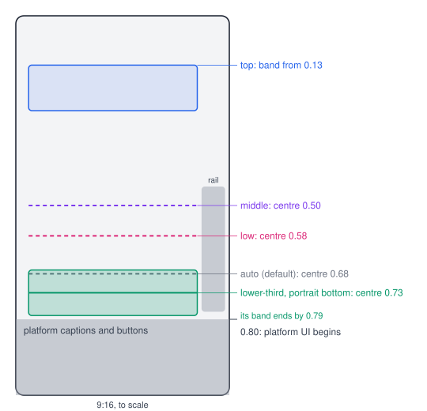

# Caption positions and colours

Set where the captions sit with `position` on the captions overlay, for example `{"type": "captions", "preset": "kinetic-hierarchy", "position": "lower-third"}`.

| `position` | Where the band sits (fraction of the frame height) |
|---|---|
| `top` | Its top edge at 0.13 (0.08 in landscape) |
| `middle` | Centred at 0.50, dead centre |
| `low` | Centred at 0.58, just below the middle: a word tag on the lower half of a panel |
| `auto` (default) | The format's own band: centred at 0.68 in portrait, in the lower title-safe area in landscape |
| `lower-third` | Centred at 0.73, about a quarter up from the bottom. Even a line that wraps ends by 0.79, above the platforms' own captions and buttons (from about 0.80 down) |
| `bottom` | In portrait, the same as `lower-third`. In landscape, the format's own band |
| `seam`, `chest` | Footage layouts: on the line between a stacked panel and the presenter, or at the presenter's chest |

The positions live in one place, `CAPTION_POSITION_CENTRE` in `kit/core/layout-check.mjs`. The renderers and the layout check both read them, so the band the layout check checks is where the captions are drawn.

## Colours on the brand surface and on footage

Caption colours are picked for what is behind each line:

- **On the brand surface** (a flat background or panel): if the caption colour doesn't reach 3:1 there, the line takes a set picked for that surface. On a light surface that means dark words with the highlight in a brand colour. On a dark surface it means light words. A caption colour you set yourself counts as a preference: it gives way only where it can't be read.
- **On footage**: the line keeps its own colours, usually light words. A line that still can't be read on busy footage gets a soft plate behind it.

`launchclip finish` decides which lines are on the surface. Lines with no footage under them are decided before the first render. After the render, any line that measures illegible on a flat backdrop is moved to the surface colours. The lines are listed in the captions overlay's `surface`, and the report is in `qa/finish/caption-legibility.json`.
