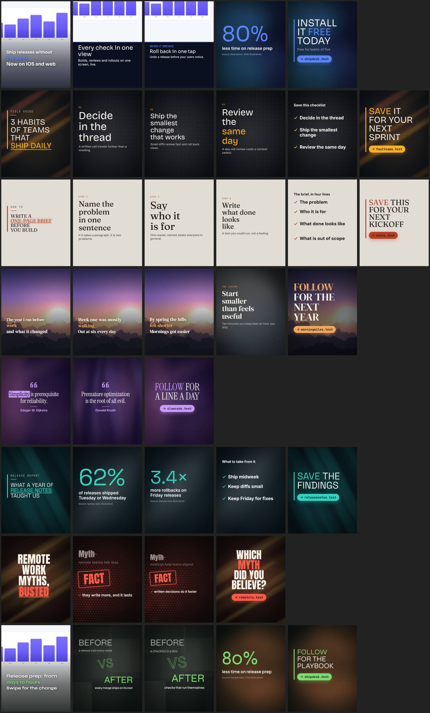
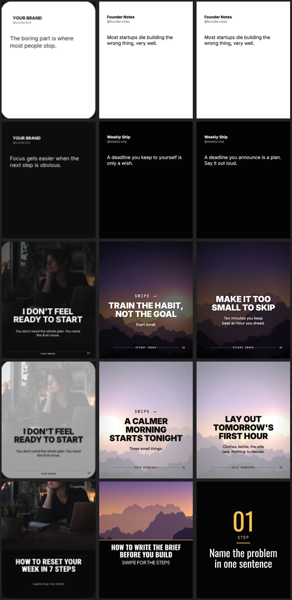
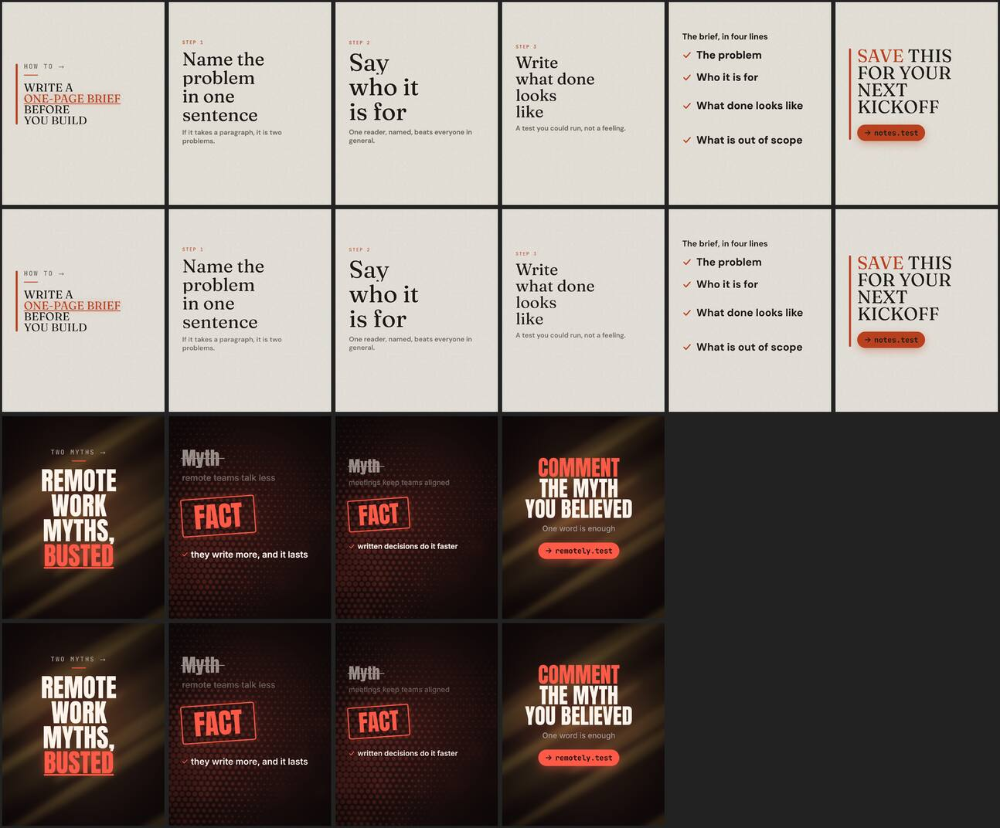

# Carousels and single-image posts

A carousel is a story whose scenes are slides. Each slide is a still (the scene's settled frame, after every entrance and before any exit) or a short clip of its own. The same plan goes to each place you post it, laid out again for that platform's canvas, with a post caption and alt text for each.

The design is in the [carousels RFC](../CAROUSELS_RFC.md). A sample project is in [`examples/carousel/listicle-4x5`](../../examples/carousel/listicle-4x5/storyboard.json).

## The four steps

```bash
launchclip carousel make "Five habits of fast teams, as a listicle to save" --dest instagram,linkedin
```

`make` plans the carousel, renders it and checks it. Each of the other commands runs one step on a project you already have:

```bash
launchclip carousel render ./my-carousel --dest instagram,linkedin
```

```bash
launchclip carousel check ./my-carousel
```

```bash
launchclip carousel export ./my-carousel
```

| Step | What it does |
|---|---|
| `make "<brief>"` | Picks the arc and a template (`listicle`, `how-to`, `myth-fact`, `before-after`, `story`, `data`, `ad`, `quote`, `single`), writes the slides, the caption and the alt text, then renders and checks |
| `render <project>` | Each slide's still, and an MP4 loop for each motion slide, into `carousel/<dest>/` as `01.png`, `02.png` … |
| `check <project>` | The slide rules: a cover that reads at thumbnail size, type large enough for the feed, one idea per slide, contrast, safe zones, a payoff where the arc promises one, alt text, and copy that is not filler, cut off, repeated or a leaked planning label. Exits 1 on a failure |
| `export <project>` | Packages each destination's files, ready to upload |

## Templates

A template is the design layer between the plan and the modules. The planner writes each slide's words (a headline, a line under it, list items, a figure with its source, a quote, a photo); the template decides how the slide is laid out, so a carousel looks designed whatever the content. Pick one with `--template <id>` or `carousel.template` in the story; without one, `make` picks from the brief.

Ten templates follow feed styles that have been proven in production, rebuilt on LaunchClip's modules and brand system. `lit-window` is LaunchClip's own.



The five styles a host app offers today, side by side with its own previews (left), our cover and a body slide:



| Template | The look | For |
|---|---|---|
| `caption-block` | The photo on top, a solid panel under it with condensed capitals; a short checklist under a slimmer photo | Education and checklists with photos |
| `cinematic-dark` | Photos edge to edge under a dark reading layer, heavy capitals in the lower middle, a small line under them, the brand name and page number along the foot | Practical advice, coaching, motivation |
| `cinematic-light` | The same under a soft light wash | The same, calmer |
| `plain-note` | A white page like a text post: the brand's name and handle at the top, one short observation under them in a regular weight | Founder notes, opinions |
| `plain-note-dark` | The same on near-black | Reminders, hot takes |
| `numbered-steps` | A photo over a black band with the promise in heavy capitals and a swipe line, then one big numbered step per slide, the checklist as numbered lines | How-tos, routines, frameworks |
| `paper-story` | Warm paper, a serif headline over a framed photo, a caption under it | Product and founder stories |
| `bold-statement` | The brand colour as the page, oversized capitals, one phrase lit | Values, manifestos, statements |
| `pull-quote` | Serif pull quotes on paper, a large quotation mark in the accent | Quotes and testimonials |
| `photo-essay` | Large photos across the top of a light page, restrained captions | Photography, recaps, trips |
| `lit-window` | Each photo in a rounded window in a soft pool of brand-coloured light, the type set free around it | Product shots, screenshots, case studies |

### How a slide gets its layout

Each slide takes one of eight layouts (grammars). The content decides first; after that comes the template's choice for the slide's role, and then type on the ground:

| Grammar | When | Drawn by |
|---|---|---|
| `two-region` | The headline opens on one marker and the body on its pair (`Myth:` / `Fact:`, `Before:` / `After:`, `Don't:` / `Do:`) | `compare` in free type |
| `proof-stat` | A `stat`, or a %, a currency amount, a multiplier, or a number with a unit such as hours or users | `stat-card` (with a source), `media-stat` (with a photo), else `concept-card` |
| `steps` | `items`, or a body with two or more sequence words (first, then, finally). A short list with a photo stays in an `image-panel` template's photo panel | `item-list` |
| `image-panel` | The template's choice, with a photo: the photo on top, the text in a panel under it | `split-screen` |
| `framed-image` | The template's choice, with a photo: the headline over a framed photo, a caption under it | `landscape-card` |
| `full-bleed` | A cover with a photo when no template is set | `photo-scene` under a reading layer |
| `step` | The template's choice: one numbered step per slide, the headline alone | `section-card` |
| `text-card` | Everything else, quotes, notes and the call to action | `hook-title`, `motion-title`, `quote-card`, `cta` |

Each grammar has the most of the slide its text may cover, type floors at 1080 wide (headline 52 px, body 46 px, scaled by width) and copy caps. A template's own caps sit inside those. Copy over a cap goes back to the planner in its repair round.

### Grounds, surfaces and colour

A template sets the carousel's ground, and a carousel has one:

- `dark` is the brand's own dark ground.
- `light` turns the brand over, so its palest colour becomes the ground and its darkest the type.
- `brand` makes the brand's primary the page.
- `pure` takes a dark or light ground to a near-black or near-white page in the brand's hue.

Type, accent and the colour on a primary fill (a call-to-action pill) are moved until they read on that ground. Each role then sits on the ground, on a plate lit in the brand colour, or `on-image`: the slide's photo behind a reading layer. Colours always come from the brand or the style pack. No template names a hex.

### The reading gradient

The reading layer is a gradient in the brand's colour rather than a flat dim. It's solid where the type sits and fades to clear, so the photo or footage shows through the rest of the slide. Both renderers draw the same CSS gradient, built once in `kit/core/reading-gradient.mjs`:

```json
"gradient": { "color": "ground", "tint": 0, "direction": "bottom", "stops": [0.62, 0.95], "opacity": 0.9 }
```

| Field | Meaning |
|---|---|
| `color` | `ground` (the page colour) or `primary`, never a hex |
| `tint` | 0 to 0.6: how much of the other colour mixes in (a ground tinted by the primary, or the primary deepened toward the ground) |
| `direction` | `bottom`, `top`, `both` (solid at the top and bottom edges, clear in the middle) or `full` (flat) |
| `stops` | `[solid, clear]` as fractions of the slide from that edge: solid up to the first, clear from the second |
| `opacity` | 0.3 to 1: the solid end's alpha |

It goes wherever a photo or video sits under type:

- An image or video plate (`plate: {kind: "video", params: {src, gradient}}`) replaces the plate's flat `dim`. A video plate raises the solid end to the contrast floor on bright footage.
- `photo-scene` takes `gradient` in place of its `scrim`.
- `split-screen` takes `fade`, a gradient anchored at the photo's seam so the photo fades into its panel.
- `carousel.panorama.reading` lays it over each slide's slice. It runs top to bottom, so the slices still meet at every seam.

A template's `reading` is `{gradient, blur}` (or the flat `{dim, blur}`), plus `panel`, the fade an image-panel photo uses into its panel. `cinematic-dark` and `cinematic-light` are solid over the lower 60% and clear at the top. `numbered-steps` fades its cover photo into the black panel, and its footage steps sit on a gradient solid over the lower 72%. `caption-block` and `photo-essay` fade the photo into the panel over the last 30% and 22% of its height. Keep the type on the solid end. `check` measures contrast on the rendered pixels, so type on the clear end fails.

A carousel slide that isn't 9:16 lays out inside the feed's margins (5% each side and at the top, 8% at the bottom), not under a Shorts-style interface, and with no captions band. 9:16 slides keep the Shorts safe zone.

### The automatic pick

Without `--template`, each template scores the brief: +2 for each `best_for` word, −3 for each `avoid_when` word, +4 when it suits the arc, and points up or down for photos. Among the templates within two points of the best, the style's seed picks one, so two carousels on the same brief rarely look the same.

The samples are in `examples/carousel/<template>-4x5` (plus `numbered-steps-9x16`), written by `node scripts/carousel-template-samples.mjs`. Their photos are stand-ins already in the repo. Remotion and HyperFrames draw the templates the same way:



## Destinations

Pick them with `--dest`, or list them in the story's `carousel.destinations`.

| Destination | Canvas | Slides | Motion slides | Export |
|---|---|---|---|---|
| `instagram` | 4:5 | up to 20 | yes | PNG per slide, MP4 per motion slide |
| `tiktok` | 9:16 | up to 35 | no | JPG per slide |
| `linkedin` | 4:5 | up to 300 | no | `slides.pdf` (a document post) and PNGs |
| `facebook` | 4:5 | up to 10 | yes | PNG and MP4 |
| `meta-ads` | 1:1 | 2 to 10 | yes | PNG and MP4, plus `cards.json` |
| `x` | 4:5 | up to 4 | yes | PNG and MP4 |
| `threads` | 4:5 | up to 20 | yes | PNG and MP4 |

These limits come from public guidance as of November 2026. Check each platform's own documentation before relying on a figure.

Where a destination takes images only, a motion slide is sent as its still, and the export says so.

A motion slide is a scene of 2 to 10 seconds, rendered as its own silent clip of exactly the scene's length. With `loop: true` its last frame leads back into its first, background included. Without it the clip plays once and ends on a settled frame. Its still is a frame of that clip and doubles as the poster. See `examples/carousel/motion-ad-1x1` for an ad whose second slide loops.

### Video carousels

A video carousel is a set of separate short videos: each card is its own clip, and a swipe moves to the next one. Most cards run 3 to 5 seconds, a single beat about 2, and a card whose motion needs the time up to 10. A card is either *drawn* (type and graphics that animate) or *footage* (a video under free type). A footage card is a `photo-scene` whose `media` is a video (`{src, sourceStart}` plays a range of a longer recording), or a type module over a video plate (`plate: {kind: "video", params: {src, start}}`). Render refuses a card whose clip ends before the card does.

```bash
launchclip carousel make "Oil a deck in one weekend" --clips ./broll
launchclip carousel make "Oil a deck in one weekend" --video --generate fal --budget 5usd
```

`--clips <dir>` hands in footage (it implies `--video`); the planner sees each clip's length and keeps every card inside its clip. `--video` plans a video carousel without footage of your own. With `--generate`, each footage card gets a keyframe still first. That still is checked, with keyframe candidates and audience-led concepts when you ask for them, and then animated into a clip of the card's length. The quote, `--budget` and draft-video gates are the same as `make`'s, and no text is drawn into the clip. The planner sizes each card and marks it as footage or drawn, and the make report lists the cards. See `examples/carousel/video-cards-4x5` for a sample.

## What export writes

For each destination, in `carousel/<dest>/`:

| File | What it's for |
|---|---|
| `01.png` … | The slides in order (`.jpg` for TikTok), and `NN.mp4` for each motion slide where motion is shown |
| `slides.pdf` | LinkedIn: one page per slide at the slide's size |
| `cards.json` | Meta ads: each card's file (the MP4 for a motion slide, with its still as `thumbnail`), headline, description and link, cut to Meta's recommended lengths (32 and 18 characters). Pass `--link <url>` for the link |
| `caption.md` | The post caption: the hook, the body, the call to action, and tags where the platform uses them (Instagram, TikTok). It flags a hook longer than the platform shows before "… more", and ends with a plain version to paste |
| `alt.json` | Alt text for each slide file |

`carousel/CAROUSEL.json` lists the plan, every destination's files, its warnings and errors, and the check results when `check` has run.

A destination whose renders are missing is reported and skipped; the others still export. `--json` prints the whole report.

## Swipe continuity

Two treatments pull the eye to the next slide. Both work in Remotion and HyperFrames, on still and motion slides, and either one counts as the swipe cue when it touches the cover or slide 2. A sample is in [`examples/carousel/seam-panorama-4x5`](../../examples/carousel/seam-panorama-4x5/storyboard.json).

**Across the seam.** An element is laid across the seam between two slides, so half of it sits at the right edge of one and the rest at the left edge of the next. List them in `carousel.seams`:

```json
{ "after": "summit", "kind": "word", "text": "KEEP CLIMBING →", "x": -0.36, "y": 0.8, "w": 0.72, "h": 0.07, "color": "ink" }
```

| Field | What it means |
|---|---|
| `after` | The id of the slide on the left of the seam |
| `kind` | `word` (text `h` tall), `rule` (a bar; a thin one is a line), `card` (a rounded bar) or `circle` |
| `x`, `w` | In slide widths from the seam. The element must cross it: `x < 0 < x + w` |
| `y`, `h` | In slide heights from the top |
| `color` | A brand colour role (`primary`, `accent`, `ink` …) or `#rrggbb` |

**The panorama.** One plate laid over several slides, each taking its slice, with type set per slide:

```json
"panorama": { "src": "assets/panorama.jpg", "slides": [1, 4] }
```

`slides` is the first and last slide it covers (1-based). The plate is scaled once to cover that many slide widths by the slide height, centred, and each slide shows its own width of it, so the slides line up pixel for pixel side by side. A plate already that size (here 4 × 1080 by 1350) is drawn unscaled. Keep the type on each slide clear of the busiest parts of the plate; `check` measures contrast on the rendered slides. Add `"reading": {…}` (a [reading gradient](#the-reading-gradient)) to lay a brand-coloured gradient over every slice.
