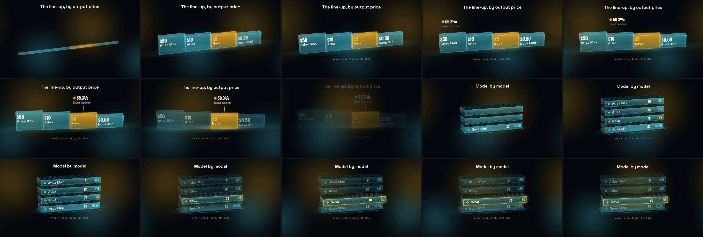
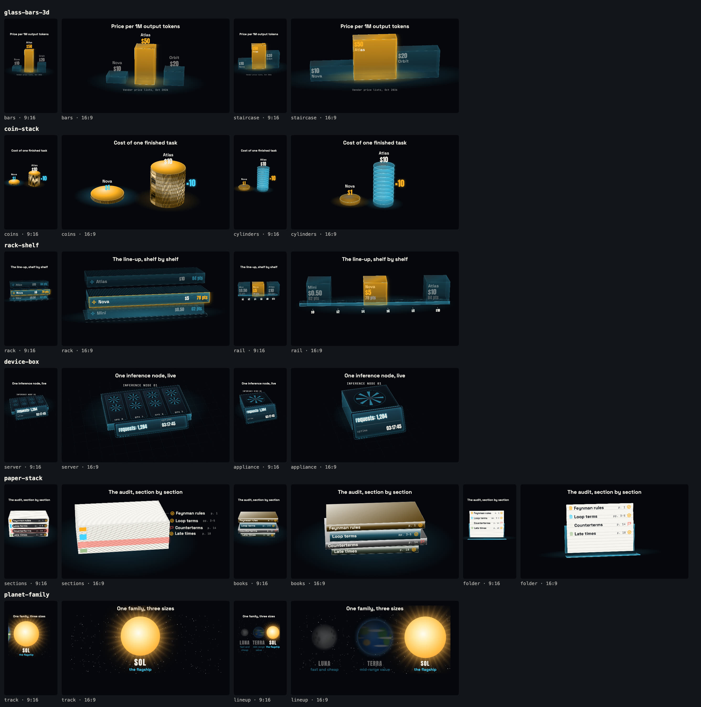
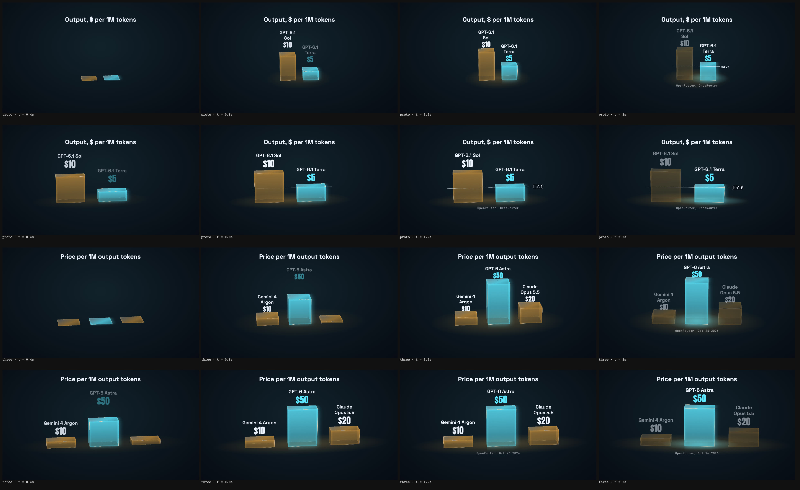

# Catalogue I: a staircase line-up, then a rack shelf

A 15 s, two-shot story built from catalogue I's 3D data objects
([KIT_CONTRACTS.md](../../../docs/KIT_CONTRACTS.md), "Catalogue I: 3D data
objects"). The names and prices are made up.



- **Shot 1, `glass-bars-3d` staircase:** four glass steps grow in, highest
  price first, with the price and name on each front face; a score marker
  hops from step to step on its cues (2.6 s, 3.7 s, 4.8 s) with a dashed
  leader; at 5.6 s the Nova step lights and the rest drop back. The camera
  orbits 14° and pushes in over the shot.
- **Shot 2, `rack-shelf`:** four trays stack in, bottom first, each a row
  with an icon, a score and a price, while the camera dollies in; at 3.6 s
  the Nova tray slides out toward the viewer and its rim lights.

Every module, every variant, both aspects (the settled frame of the sample
params in `scripts/element-samples.mjs`):



glass-bars-3d at hero scale (rows: the Terra prototype's two bars before
and after, then three bars before and after; columns at 0.4, 0.8, 1.2 and 3 s
from the scene start): wide bars that span the rect, one-line names, the
"half" reference as a chip facing the camera, readable height by 0.4 s.



Reproduce it:

```bash
node bin/launchclip.js story compile examples/story/catalog-i-3d --renderer hyperframes --out /tmp/catalog-i-hf
npx hyperframes render /tmp/catalog-i-hf --output catalog-i.mp4 --quality high
node scripts/element-sheet.mjs --modules glass-bars-3d,coin-stack,rack-shelf,device-box,paper-stack,planet-family
```
