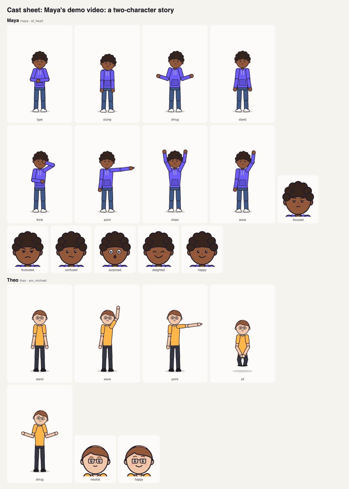
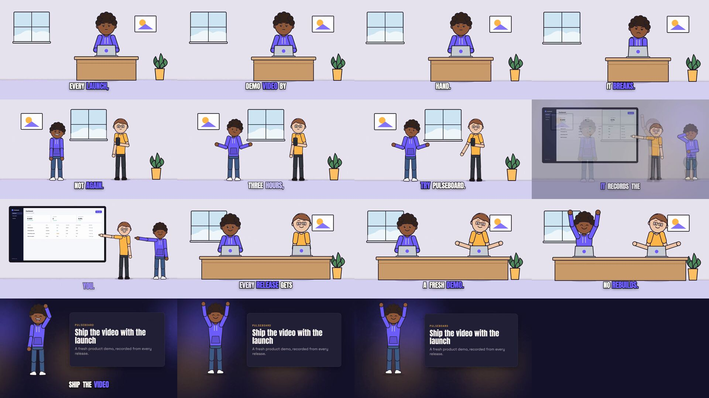

# Character story: someone hits the problem, then the product fixes it

A 23 s, two-character story told with LaunchClip's animated characters
([VIDEO_QUALITY_RFC.md](../../../docs/VIDEO_QUALITY_RFC.md) §10.5). Maya rebuilds a
demo video by hand and it breaks; Theo shows Maya Pulseboard (the made-up
analytics app in [examples/demo-app](../../demo-app)); the screen plays a real
demo-autopilot recording of it, never an invented UI; the cast celebrates and
the close is a cameo beside a card.





- **Cast:** `maya` and `theo` from the starter cast, named once in
  `storyboard.json` `cast`; scenes refer to them by id, so they look the same
  in every shot.
- **Sets:** `desk-laptop` (twice), `phone`, `screen` (playing
  `assets/demo/create-project.mp4`), then a `character-cameo`.
- **Narrative map:** `DIRECTION.json` gives each line a story beat (setup,
  problem, turn, resolution, cta), its set and who acts; it lands inside the
  `story-characters` profile's bands.
- **Acting:** poses and expressions are cued to narration words
  (`"at": "word:breaks."`), so a resynthesised voice keeps them in time.
- **Dialogue:** `audio.narration.lines` gives each line a speaker. The
  narrator speaks in `bf_emma`; Maya and Theo in their cast voices
  (`af_heart`, `am_michael`, local Kokoro). `says: "auto"` opens a
  character's mouth on its own words.

Reproduce it:

```bash
# Every character in every pose it uses, to qa/cast-sheet.png
launchclip cast sheet examples/story/characters-16x9

# Voices, music, render, master and gates (the cast gate included)
launchclip finish examples/story/characters-16x9 --renderer remotion --music synth
```

`NARRATION.json` is a hand-timed stand-in so the story validates and its
anchors resolve before the voice stage runs; `finish` replaces it with the
real word timings of the synthesised dialogue.
