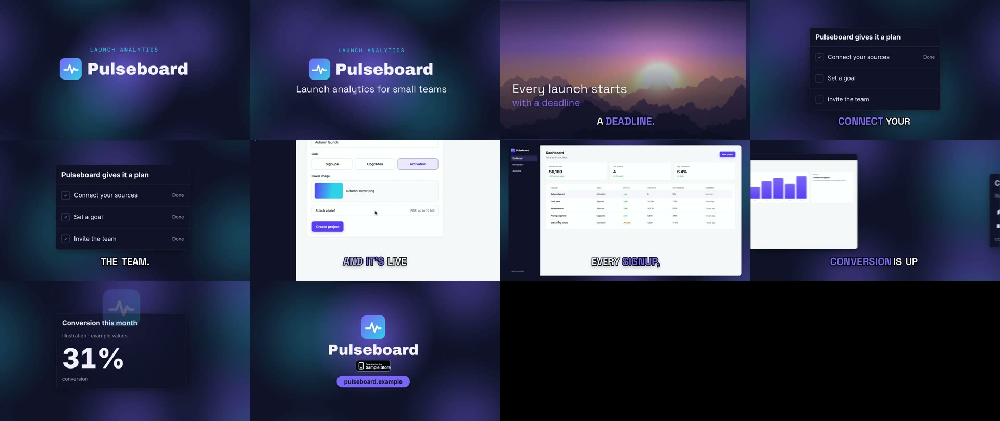

# Cinematic sample: a 31 s Pulseboard promo

[Pulseboard](../../demo-app) is a made-up analytics SaaS. This project shows the `cinematic` motion grammar on the world camera, with the `brand-lockup` and `photo-scene` modules:

- `s1`: a `brand-lockup` title card (the logo mark and the wordmark image, tinted to paper).
- `s2`: a `photo-scene` with a slow push-in and two kinetic lines.
- `s3`: a `checklist` panel.
- `s4`: a `product-demo` of the recorded flow that uploads a cover image and a PDF brief.
- `s5`: a `media-window`.
- `s6`: a `metric` panel.
- `s7`: a `brand-lockup` end card: the mark above the wordmark, a store badge and a URL pill.

The narration uses the local Kokoro voice, and the music is the synth bed.



All the artwork is made up for the sample. The logo, the wordmark (set in Archivo Black, SIL OFL) and the generic "Sample Store" badge are drawn for it. The mountain photo is generated, and the numbers are illustrative.

Reproduce it:

```bash
# Voice, music, SFX, render, master and gates
launchclip voice examples/story/cinematic-16x9
launchclip finish examples/story/cinematic-16x9 --renderer hyperframes --music synth
```

`assets/demo/` holds the `create-project` flow from [`examples/demo-app/demo/DEMO-PLAN.json`](../../demo-app/demo/DEMO-PLAN.json). It was recorded with the demo recorder's `upload` step:

```bash
launchclip demo record examples/demo-app --plan examples/demo-app/demo/DEMO-PLAN.json --no-seed --flows create-project --out <dir> --approve
launchclip demo scene <dir> --flow create-project --source-start 4.2 --duration 4.8 --src assets/demo/create-project.mp4
```

All five automatic gates passed: layout, loudness, motion, audio and temporal evidence. The HyperFrames render took 62 s on an Apple-silicon Mac. One expected warning: in world camera mode the `product-demo` video is root media, so it crossfades in rather than travelling with the camera.
