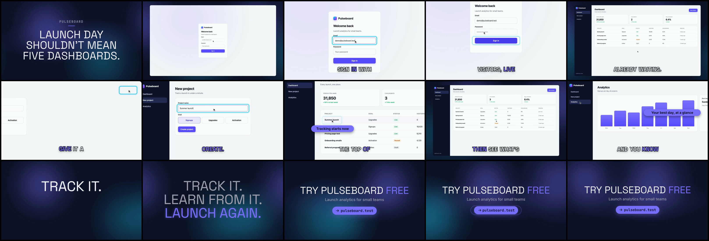

# Demo autopilot proof: a 45 s Pulseboard launch video

[Pulseboard](../../demo-app) is a made-up analytics SaaS (its data and URL are fictional). This project is the video demo autopilot made from it: three product flows recorded from the running app, edited in as `product-demo` scenes between a hook, a kinetic close and a CTA, with the local Kokoro voice and the synth music bed.



Reproduce it:

```bash
# Record the flows in DEMO-PLAN.json (seeds and starts the app, then stops it)
launchclip demo record examples/demo-app --plan examples/story/demo-autopilot-16x9/DEMO-PLAN.json --out examples/story/demo-autopilot-16x9/assets/demo --approve
launchclip demo approve examples/story/demo-autopilot-16x9/assets/demo

# Scene params for each flow (pasted into storyboard.json unchanged)
launchclip demo scene examples/story/demo-autopilot-16x9/assets/demo --flow create-project --duration 11.2

# Voice, music, SFX, render, master and gates
launchclip voice examples/story/demo-autopilot-16x9
launchclip finish examples/story/demo-autopilot-16x9 --renderer hyperframes --music synth --voice kokoro
```

`assets/demo/` holds the recorded clips, each flow's action log (`<flow>.actions.json`), the contact sheets reviewed before use (`<flow>.sheet.png`), `REVIEW.md` and the recording receipt.

The recorded draft rendered in 114 s on an Apple-silicon Mac. All five automatic gates passed: layout, loudness (−14 LUFS), motion, audio and temporal evidence.
