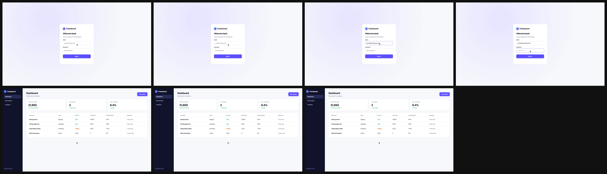
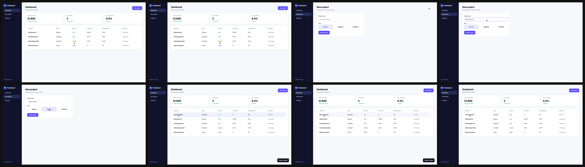
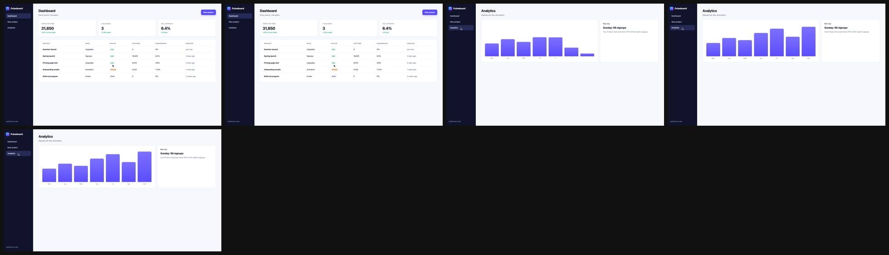

# Recorded demo flows: review before use

Recorded from http://localhost:4310 on 2026-10-22T20:19:41.119Z. Nothing is used in a video until you approve it:

```bash
launchclip demo approve examples/story/demo-autopilot-16x9/assets/demo [--flows sign-in,create-project,analytics]
```

## Sign in (`sign-in`), 9.7 s, approved



- Clip: `sign-in.mp4`
- Action log: `sign-in.actions.json`
- Actions: goto /login → type "Email" → type "Password" → click "Sign in" → wait-for "Visitors this week"

## Create a project (`create-project`), 11.2 s, approved



- Clip: `create-project.mp4`
- Action log: `create-project.actions.json`
- Actions: goto /dashboard → click "New project" → type "Project name" → click "Goal: Upgrades" → click "Create project" → wait-for "Summer launch"

## Analytics (`analytics`), 6.5 s, approved



- Clip: `analytics.mp4`
- Action log: `analytics.actions.json`
- Actions: goto /dashboard → click "Analytics" → assert-visible "Sunday: 96 signups"

