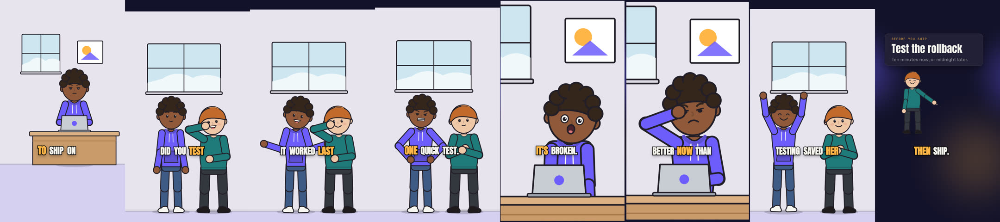

# Dialogue: two characters, a script and a shot list

A 23 s vertical story in five shots. Maya is about to ship on a Friday, Sam
asks whether she tested the rollback, and she had not. It shows the shot
fields of the animation pipeline: a script with speakers and silent lines,
a direction map whose lines name the script lines they play, and the shot
list the two files make.



- **`SCRIPT.json`** (`launchclip.make-script.v2`): ten lines in six beats.
  Eight are spoken, by the narrator, `maya` and `sam`; two are silent
  (`"speaker": null`, an `action` and its `seconds`).
- **`storyboard.json`**: the eight spoken lines are `audio.narration.lines`,
  each with its speaker; a silent line is the `gap` after the line before
  it. Four `cast-scene` shots and a `character-cameo` close.
- **`DIRECTION.json`**: every line carries `"line": "l…"`, the script line it
  plays, beside its word range, key action and cast cues.
- **A line spoken off screen.** In the `test` shot Sam says "Better now than
  at midnight." while the picture stays on Maya. A character who speaks has
  to be on screen, so the line says why: `"why": "Sam speaks from behind
  her; we stay on Maya as it sinks in"`. Remove the `why` and
  `story validate` fails the line.

```bash
# Validate the storyboard, the map and the script line ids
launchclip story validate examples/story/dialogue-9x16/storyboard.json

# The shot list: frames, who, set, framing, poses and lines (--json for data)
launchclip story shots examples/story/dialogue-9x16

# Voices, render, master and gates
launchclip finish examples/story/dialogue-9x16 --renderer hyperframes --music synth
```

The start of the shot list:

```text
Test the rollback: a two-character dialogue: 5 shots, 23.50 s at 30 fps

 1  desk  0.00–3.38 s  frames 0–100 (101)
    cast-scene · set desk-laptop · wide shot · beat setup
    who: maya
    key action: maya type (l1)
    maya: 0.00 type, focused
    0.30–3.10  l1 narrator: "Maya is about to ship on a Friday."

 2  ask  3.38–10.91 s  frames 101–326 (226)
    cast-scene · set standing · medium shot · beat problem, attempt
    who: maya, sam
    key action: sam think (l2)
    key action: maya shrug (l3)
    key action: maya hands-on-hips (l5)
    maya: 3.38 stand, neutral → 6.11 shrug, happy → 8.84 hands-on-hips, frustrated
    sam: 3.38 stand, neutral → 3.63 think, happy → 7.28 arms-crossed, neutral
    3.63–5.58  l2 sam: "Did you test the rollback?"  [light, as if in passing]
    6.11–7.66  l3 maya: "It worked last month."  [breezy]
    8.84–10.53  l5 maya: "Fine. One quick test."  [giving in]
```

`NARRATION.json` is a hand-timed stand-in with a speaker on every word, so
the story validates and its anchors resolve before the voice stage runs;
`finish` replaces it with the word timings of the synthesised dialogue.
